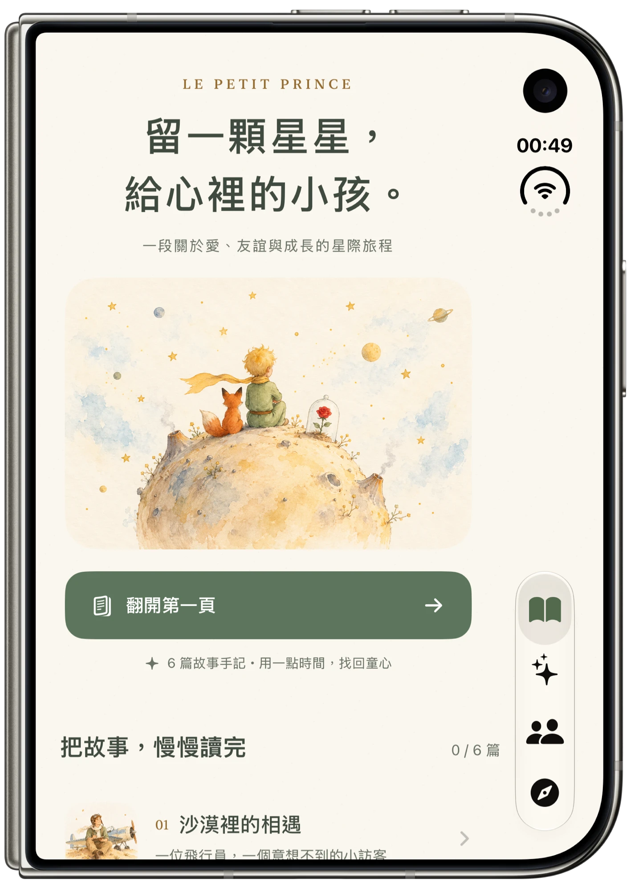
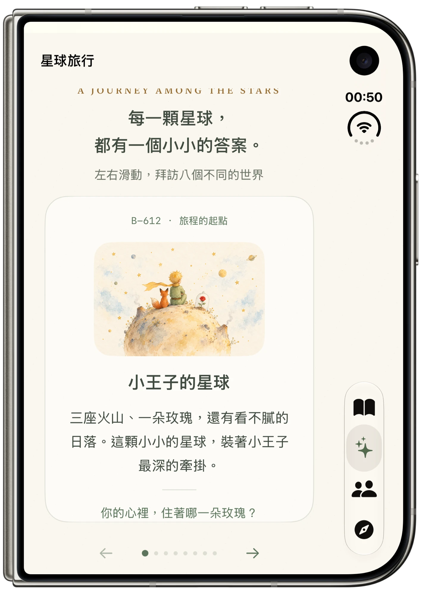
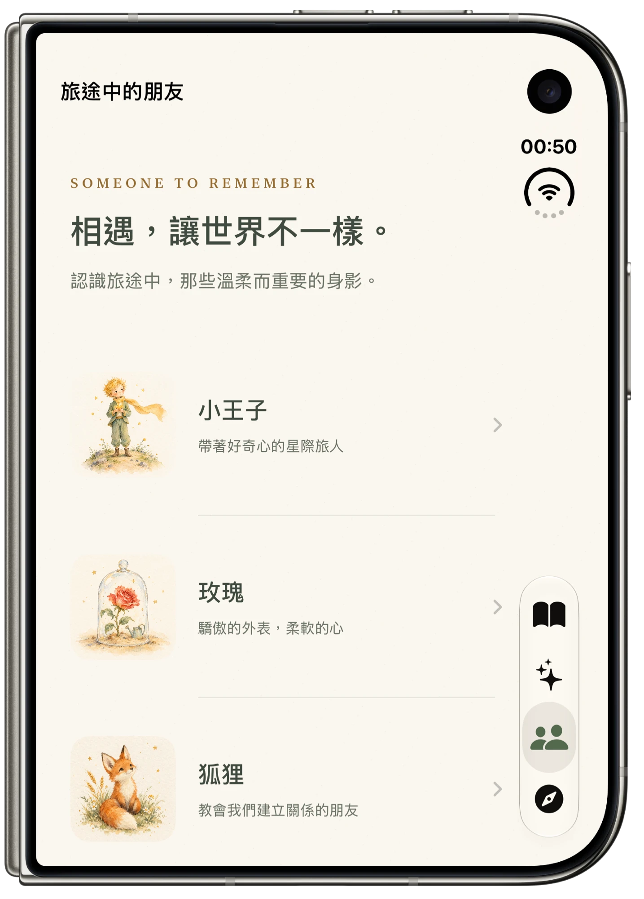
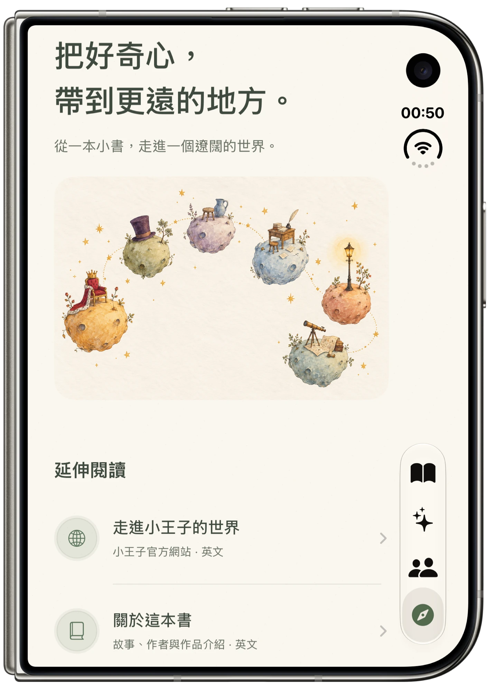

<a id="top"></a>

<div align="center">

# 🌹 LittlePrince · 小王子

**🌐 [English](#english) · [繁體中文](#zh-tw)**

[](#requirements)
[](#requirements)
[](https://www.swift.org/)
[](https://developer.apple.com/xcode/swiftui/)
[](https://developer.apple.com/xcode/)
[](#tech-highlights)
[](#zh-tw)
[](https://github.com/PeterPanSwift/LittlePrince/commits/main)

<table>
  <tr>
    <td align="center"></td>
    <td align="center"></td>
    <td align="center"></td>
    <td align="center"></td>
  </tr>
  <tr>
    <td align="center">📖 Stories · 故事</td>
    <td align="center">✨ Planets · 星球旅行</td>
    <td align="center">👥 Characters · 角色</td>
    <td align="center">🧭 Explore · 探索</td>
  </tr>
</table>

</div>

---

<a id="english"></a>

## 🇺🇸 English

> **🌐 English** · [繁體中文](#zh-tw)

A watercolor storybook guide to *The Little Prince*, built entirely with SwiftUI. Cream paper textures, soft illustrations and short reading prompts invite you to revisit the story at your own pace.

The in-app content is written in Traditional Chinese.

### ✨ Features

- 📖 **Six story chapters:** self-written summaries, each ending with a question to reflect on.
- ✅ **Reading progress:** mark chapters as read. Progress is saved on your device, and tapping again removes the mark.
- 🪐 **Eight-stop planet journey:** swipe from B-612 through the six asteroids to Earth, or use the page dots and previous / next buttons.
- 🦊 **Four characters:** the Little Prince, the rose, the fox and the pilot, each linked to a related chapter.
- 🧭 **Further reading:** three official sites about the book and its author open in an in-app web view, with loading progress, error messages and retry.
- 📴 **Offline reading:** stories, characters, planets and illustrations ship with the app. Only the external websites need a connection.

<a id="tech-highlights"></a>

### 🛠️ Tech highlights

| Topic | Implementation | Where |
| --- | --- | --- |
| Tab navigation | `TabView` with `Tab` | `ContentView.swift` |
| Drill-down navigation | `NavigationStack` and `NavigationLink`, passing data to detail views | `StoryHomeView.swift`, `CharactersView.swift`, `ExploreView.swift` |
| Paged content | `TabView(selection:)` with `.tabViewStyle(.page)` on iOS, horizontal snapping scroll on macOS | `PlanetJourneyView.swift` |
| Lists | `List` with custom row styling | `StoryHomeView.swift`, `CharactersView.swift`, `ExploreView.swift` |
| Data model | `Identifiable` structs with stable IDs | `StoryData.swift` |
| Persistence | `@AppStorage` | `StoryHomeView.swift`, `ChapterDetailView.swift` |
| Web content | WebKit's native SwiftUI `WebView` and `WebPage` | `ResourceWebView.swift` |
| Visual style | Shared theme, illustration mapping and accessibility descriptions | `StoryTheme.swift`, `StoryArtwork.swift` |

There are no third-party dependencies. See the [implementation notes](Documentation/IMPLEMENTATION.md) (in Traditional Chinese) for more detail.

<a id="requirements"></a>

### 🚀 Getting started

**Requirements:** Xcode 27.2 or later. The project's deployment targets are iOS 27.2 and macOS 27.0.

1. Clone the repository and open the project:

   ```bash
   git clone https://github.com/PeterPanSwift/LittlePrince.git
   ```

   ```bash
   open LittlePrince/LittlePrince.xcodeproj
   ```

2. Select the `LittlePrince` scheme and an iPhone simulator.
3. Press <kbd>⌘</kbd> <kbd>R</kbd> to run.

To run on a physical device, choose your own development team under **Signing & Capabilities**.

### 📁 Project structure

```text
LittlePrince/
├── MyApp.swift             # App entry point
├── ContentView.swift       # The four main tabs
├── StoryHomeView.swift     # Home screen and chapter list
├── ChapterDetailView.swift # Chapter reader and read marker
├── PlanetJourneyView.swift # Paged planet journey
├── CharactersView.swift    # Character list and details
├── ExploreView.swift       # Further reading and about the book
├── ResourceWebView.swift   # In-app web view
├── StoryData.swift         # Chapters, planets, characters and links
├── StoryTheme.swift        # Colors, paper background and shared styles
├── StoryArtwork.swift      # Illustration mapping and descriptions
└── Assets.xcassets         # Watercolor illustrations
```

### 📝 About the content

This is an unofficial reading guide, not the original text or an official app. The summaries and questions are self-written, and the illustrations are AI-generated. *The Little Prince* was written by Antoine de Saint-Exupéry and first published in 1943. For official information, visit [lepetitprince.com](https://www.lepetitprince.com/en/) and the [author's website](https://www.antoinedesaintexupery.org/).

<p align="right"><a href="#top">⬆️ Back to top</a></p>

---

<a id="zh-tw"></a>

## 🇹🇼 繁體中文

> [English](#english) · **🌐 繁體中文**

一本用 SwiftUI 打造的《小王子》水彩故事導讀。奶油色的紙張質感、柔和的插畫與簡短的閱讀提問，陪你用自己的步調重新走進這個故事。

### ✨ 功能特色

- 📖 **六篇故事：** 自行整理的故事摘要，每篇都以一個提問作結，留下思考的空間。
- ✅ **閱讀進度：** 讀完後可以標記，進度會保存在裝置上，再點一次即可取消。
- 🪐 **八站星球旅行：** 從 B-612 出發，經過六顆小行星，最後抵達地球；可以左右滑動，也能使用頁碼圓點與上／下一站按鈕。
- 🦊 **四位角色：** 小王子、玫瑰、狐狸與飛行員，每位角色都連結到相關的故事。
- 🧭 **延伸閱讀：** 在 App 內開啟三個作品與作者的官方網站，提供載入進度、錯誤提示與重試。
- 📴 **離線閱讀：** 故事、角色、星球與插畫都隨 App 提供，只有外部網站需要網路。

### 🛠️ 技術重點

| 主題 | 實作方式 | 檔案位置 |
| --- | --- | --- |
| 分頁導覽 | `TabView` 與 `Tab` | `ContentView.swift` |
| 頁面導覽 | `NavigationStack` 與 `NavigationLink`，將資料傳到詳細頁 | `StoryHomeView.swift`、`CharactersView.swift`、`ExploreView.swift` |
| 水平分頁 | iOS 使用 `TabView(selection:)` 搭配 `.tabViewStyle(.page)`；macOS 使用水平捲動與對齊分頁 | `PlanetJourneyView.swift` |
| 列表 | `List` 搭配自訂列樣式 | `StoryHomeView.swift`、`CharactersView.swift`、`ExploreView.swift` |
| 資料模型 | 具備穩定 ID 的 `Identifiable` struct | `StoryData.swift` |
| 資料保存 | `@AppStorage` | `StoryHomeView.swift`、`ChapterDetailView.swift` |
| 網頁內容 | WebKit 原生 SwiftUI `WebView` 與 `WebPage` | `ResourceWebView.swift` |
| 視覺風格 | 共用主題、插畫對應與無障礙說明 | `StoryTheme.swift`、`StoryArtwork.swift` |

專案沒有使用第三方套件。更多細節請參考[實作說明](Documentation/IMPLEMENTATION.md)。

### 🚀 開始使用

**系統需求：** Xcode 27.2 或更新版本。專案的部署版本為 iOS 27.2 與 macOS 27.0。

1. 下載專案並開啟：

   ```bash
   git clone https://github.com/PeterPanSwift/LittlePrince.git
   ```

   ```bash
   open LittlePrince/LittlePrince.xcodeproj
   ```

2. 選取 `LittlePrince` scheme 與 iPhone 模擬器。
3. 按下 <kbd>⌘</kbd> <kbd>R</kbd> 執行。

若要在實體裝置上執行，請到 **Signing & Capabilities** 選擇自己的開發團隊。

### 📁 專案結構

```text
LittlePrince/
├── MyApp.swift             # App 進入點
├── ContentView.swift       # 四個主要分頁
├── StoryHomeView.swift     # 首頁與故事列表
├── ChapterDetailView.swift # 故事內容與閱讀標記
├── PlanetJourneyView.swift # 星球旅行分頁
├── CharactersView.swift    # 角色列表與詳細頁
├── ExploreView.swift       # 延伸閱讀與作品介紹
├── ResourceWebView.swift   # App 內網頁
├── StoryData.swift         # 故事、星球、角色與連結資料
├── StoryTheme.swift        # 色彩、紙張背景與共用樣式
├── StoryArtwork.swift      # 插畫對應與無障礙說明
└── Assets.xcassets         # 水彩插畫
```

### 📝 關於內容

此 App 為非官方的故事導讀，並非原著全文或官方 App。故事摘要與提問為自行整理，插畫為 AI 生成。《小王子》由安東尼・聖修伯里創作，於 1943 年首次出版。官方資訊請參考[小王子官方網站](https://www.lepetitprince.com/en/)與[作者官方網站](https://www.antoinedesaintexupery.org/)。

<p align="right"><a href="#top">⬆️ 回到頂端</a></p>
